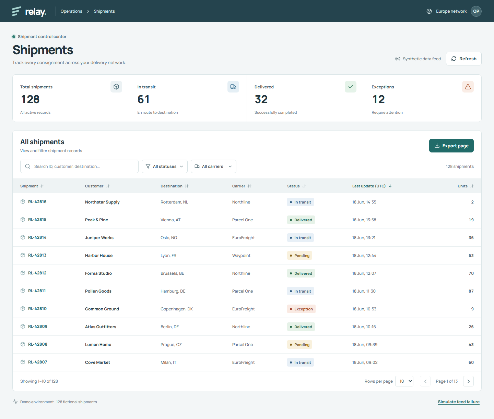

# Enterprise Data Grid — Relay

An interactive operations console for a fictional European shipping network. Built from scratch as a frontend portfolio project with React, strict TypeScript, TanStack Table and TanStack Query.

[](https://github.com/bodyan359/enterprise-data-grid/actions/workflows/ci.yml)



## What it demonstrates

- Search 128 deterministic, fictional shipment records, combining status and carrier filters.
- Sort all records before pagination; multi-column sorting with Shift + click.
- Server-style pagination (10, 25 or 50 rows), a stable sort tie-breaker, and filter changes that reset the page.
- TanStack Query caching, cancellation and refresh; intentional loading, empty and error states with recovery.
- Export the current page to a CSV that escapes quoted fields.
- Responsive controls, a semantic table with sortable column headers, keyboard focus and reduced-motion support.

Use **Simulate feed failure** under the table to exercise the error state, then **Retry** to recover. Search for an unmatched ID to see the empty state.

## Run locally

Requires Node.js 22.12+ and npm.

```bash
npm ci
npm run dev
```

## Design and data flow

```text
User controls → typed request → TanStack Query
                                  ↓
                         async data adapter
                                  ↓
             filter → sort → page + matching total
                                  ↓
                      TanStack Table → UI
```

| File | Responsibility |
| --- | --- |
| `src/data/shipments.ts` | Typed fixture, pure selection function, abort-aware simulated transport and CSV serialization |
| `src/App.tsx` | Controlled filter, sort and page state; query integration; semantic table and feedback |
| `src/styles.css` | Responsive, operations-focused visual system |
| `src/data/shipments.test.ts` | Native Node test runner: invariants for filtering, pagination, sorting, cancellation, failure and export |
| `tests/e2e/grid.spec.ts` | Browser-level workflows |

The data adapter simulates latency and supports abort signals. It is not a real API or a benchmark of backend throughput. TanStack Table uses manual sorting/filtering/pagination to avoid applying those operations twice; the adapter owns the actual data transformation.

The dashboard totals represent the complete fictional network, not the currently filtered page. The dataset is deliberately static so tests and demonstrations are reproducible. Production trade-offs would include backend authorization, a real row-count endpoint, request debouncing for high-latency search and monitoring.

## Verification

```bash
npm test
npm run build
npx playwright install chromium
npm run test:e2e
```

The GitHub Actions workflow installs the lockfile, runs unit tests, type-checks and builds the app, and exercises the Chromium browser workflows. Playwright reports are available as workflow artifacts.

All code, branding, fictional records and design were created for this repository. No employer or client materials are included.
